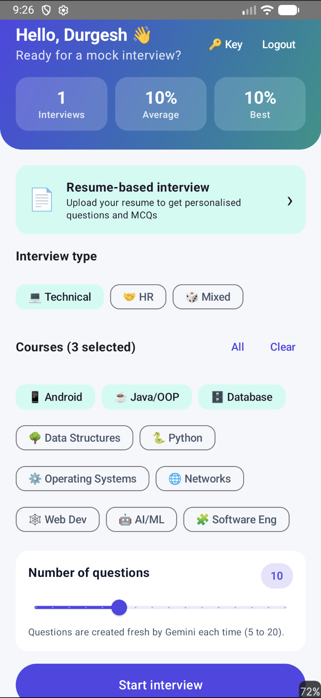
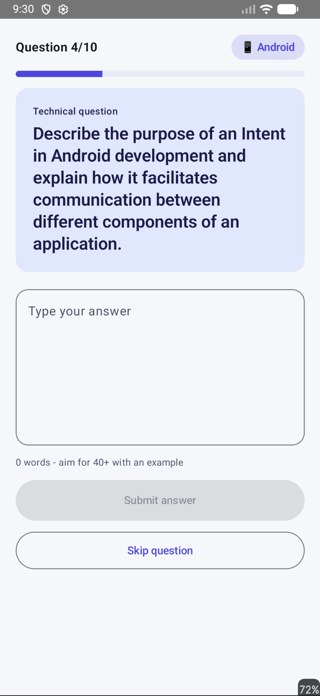
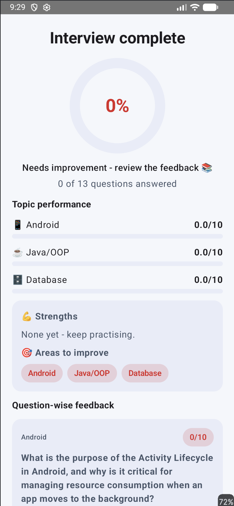
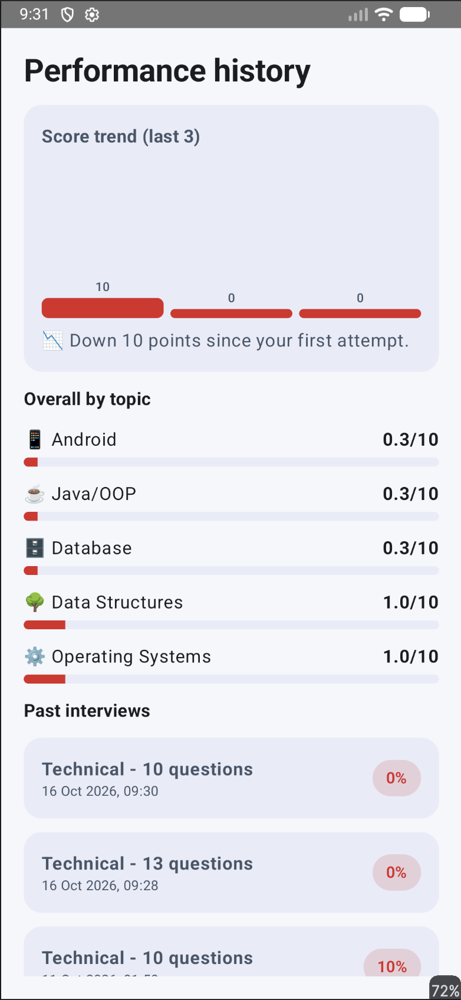
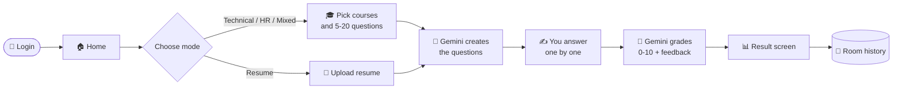

<div align="center">

# AI Interviewer

### Smart Interview & Evaluation System

**Practise like it's the real thing.** An Android app that conducts personalised technical, HR and resume-based mock interviews, scores every answer with Gemini AI, and tracks your progress over time.

<br>


<br>

[✨ Features](#-features) · [📸 Screenshots](#-screenshots) · [🧠 How it works](#-how-it-works) · [🚀 Getting started](#-getting-started) · [🗂️ Project structure](#️-project-structure) · [🗺️ Roadmap](#️-roadmap)

</div>

---

## ✨ Features

<table>
<tr>
<td width="50%" valign="top">

### 🤖 AI-generated questions
Gemini writes a **fresh set of questions every time**, so no two interviews are the same. Difficulty is varied from easy to hard.

### 🎓 10 technical courses + HR
Android · Java/OOP · Database · Data Structures · Python · Operating Systems · Networks · Web Dev · AI/ML · Software Engineering, plus HR and behavioural rounds.

### 🎚️ You choose the interview
Pick **Technical, HR or Mixed**, select any combination of courses, and set **5 to 20 questions**.

</td>
<td width="50%" valign="top">

### 📄 Resume-based interview
Upload a **PDF, DOCX or TXT** resume. Gemini reads it and asks about *your* projects, skills and experience, with **MCQs** on the technologies you list.

### 🧮 Smart evaluation
Every written answer is graded **0–10** on meaning (not keywords), with written feedback and an **ideal answer** so you learn what you missed.

### 📊 Track your growth
Score ring, strengths and weak areas by topic, a trend chart, and a full history for every account.

</td>
</tr>
</table>

### And more

- 🔐 **Login and sign-up** with PBKDF2-hashed passwords; each user gets their own private history
- 🌗 **Light and dark themes** with a clean Material 3 design
- 🔑 **Bring your own API key**: it is entered in the app and kept on your device, never baked into the APK
- ⚡ **MCQs checked instantly** for a quick-fire round

---

## 📸 Screenshots

> Add your screenshots to a `screenshots/` folder and update the file names below.

<div align="center">

| Home | Interview | Result | History |
|:---:|:---:|:---:|:---:|
|  |  |  |  |

</div>

---

## 🧠 How it works



### Scoring guide

| Score | Meaning |
|:---:|---|
| 🟥 **0 – 2** | Wrong or irrelevant |
| 🟧 **3 – 4** | Weak, key points missing |
| 🟨 **5 – 6** | Acceptable, needs more depth |
| 🟩 **7 – 8** | Good answer |
| 🟢 **9 – 10** | Excellent |

The overall result is `total score × 100 ÷ (questions × 10)`. A topic averaging **7 or more** counts as a **strength**, and one **below 5** is flagged as an **area to improve**.

---

## 🛠️ Tech stack

| Layer | Technology |
|---|---|
| Language | Kotlin |
| UI | Jetpack Compose, Material 3, Navigation Compose |
| Architecture | MVVM with `ViewModel` and Compose state |
| Local database | Room (via KSP) |
| Async | Kotlin Coroutines and Flow |
| AI | Google Gemini API (REST, `generateContent`) |
| Resume parsing | PdfBox-Android (PDF), ZIP/XML parsing (DOCX), plain text |
| Security | PBKDF2 password hashing, key stored on-device |

---

## 🚀 Getting started

### Prerequisites

- **Android Studio** Koala or newer
- An Android device or emulator running **Android 7.0 (API 24) or higher**
- A free **Gemini API key** from [Google AI Studio](https://aistudio.google.com/apikey)

### Setup

```bash
# 1. Clone the repository
git clone https://github.com/durgeshmahajann/AIInterviewer.git

# 2. Open the folder in Android Studio and wait for Gradle sync
# 3. Press Run ▶
```

### Add your Gemini API key

**Option A: inside the app (recommended)**

1. Run the app and sign up.
2. Tap **🔑 Key** on the home screen.
3. Paste your key and tap **Save**.

**Option B: default key for your own builds**

Add this line to `local.properties` (it is git-ignored):

```properties
GEMINI_API_KEY=your_key_here
```

> ⚠️ **Never commit your API key.** `local.properties` is listed in `.gitignore`. If a key is ever exposed, delete it at [AI Studio](https://aistudio.google.com/apikey) and create a new one.

<details>
<summary><b>🧯 Troubleshooting</b></summary>

<br>

| Problem | Fix |
|---|---|
| *Invalid or unauthorised Gemini API key* | Re-copy the key with no spaces and save it again |
| *Gemini rate limit reached* | The free tier has limits. Wait a minute and retry |
| *Model not found* | Change `MODEL` in `ai/GeminiClient.kt` to a current Gemini model |
| *Couldn't find readable text in this file* | The PDF is a scan or image. Use a text-based PDF, DOCX or TXT |
| Gradle sync fails | Use JDK 17 or newer and install Android SDK Platform 34 |

</details>

---

## 🗂️ Project structure

```
app/src/main/java/com/example/aiinterviewer/
├── MainActivity.kt            # Navigation host and login/logout routing
├── ai/
│   ├── GeminiClient.kt        # REST client + on-device API key store
│   └── GeminiService.kt       # Question generation, resume questions, grading
├── data/
│   ├── Models.kt              # Question, Eval, AnswerEval, Category
│   ├── Courses.kt             # Course list and emojis
│   └── Database.kt            # Room: users and interview sessions
├── resume/
│   └── ResumeExtractor.kt     # PDF / DOCX / TXT to plain text
└── ui/
    ├── Theme.kt               # Material 3 light/dark theme
    ├── Components.kt          # Score ring, pills, gradient header, fields
    ├── AuthViewModel.kt       # Register / login / logout
    ├── AuthScreens.kt         # Login and sign-up screens
    ├── InterviewViewModel.kt  # Interview state, generation, grading, history
    ├── Screens.kt             # Home, interview, result, history
    └── ResumeScreen.kt        # Resume upload and options
```

---

## 🔒 Privacy and security

- 🔐 Passwords are **salted and hashed (PBKDF2)** and stored only on the device.
- 🔑 Your API key lives in the app's private storage, not in the APK.
- 📄 Your resume text is sent to the Gemini API to create questions. It is **not saved** by the app.
- 💾 Interview history stays in a local database on your phone.

## ⚠️ Known limitations

- Needs an **internet connection**, since questions and grading come from Gemini.
- The free Gemini tier has **rate limits**.
- Scanned or image-only PDF resumes are not supported.
- Accounts are local to each device, with no cloud sync.

---

## 🗺️ Roadmap

- [ ] 🎤 Voice answers with speech-to-text
- [ ] ⏱️ Timed questions and a countdown mode
- [ ] 📑 Export an interview report as PDF
- [ ] ☁️ Cloud sync with Firebase
- [ ] 🧑‍💼 Follow-up questions based on your previous answer
- [ ] 🌍 More courses and multi-language support

---

## 👨‍💻 Author

**Durgesh Mahajan**, **Ayush Unhale** and **Somesh Singh**

B.Tech, Information Technology · Bharati Vidyapeeth (Deemed to be University) College of Engineering, Pune
Built as part of the *Mobile Application Development* course.

[](https://github.com/durgeshmahajann)

---

<div align="center">

⭐ **If this project helped you, give it a star!** ⭐

<sub>Made with ❤️ and Kotlin · For educational purposes</sub>

</div>
